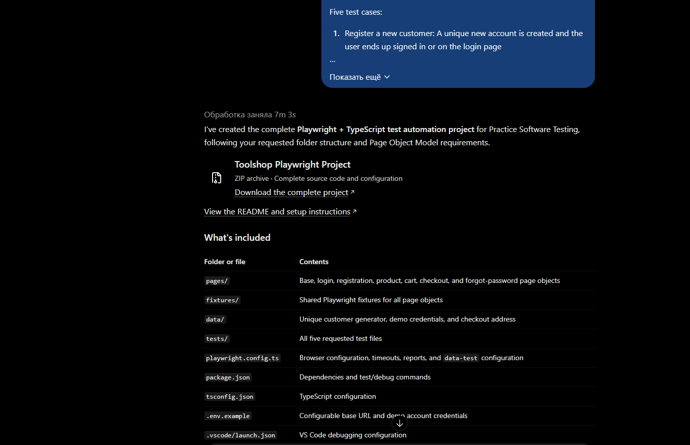
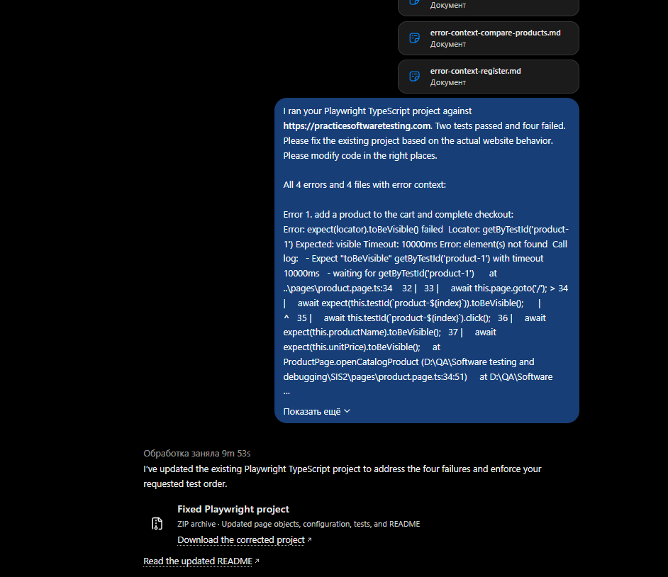
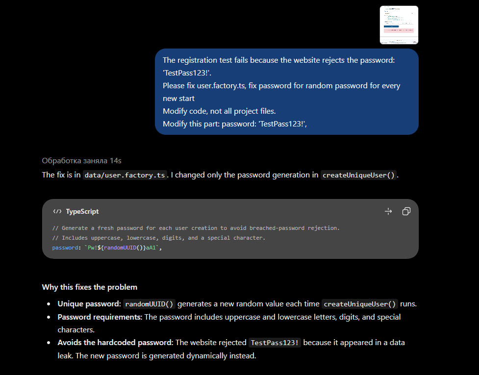

# My AI Prompts for SIS

**Student Assignment:** SIS 2 - Test Automation with Playwright  
**Course:** Software Testing and Debugging, KBTU  
**AI Tool Used:** ChatGPT - GPT-6 Thinking

Here are the actual prompts I used while working on this assignment. I used AI as an assistant to scaffold the Page Objects and test structure, then iterated on specific problems I encountered while testing the website.

---

## Prompt 1: Initial Suite & Page Object Model



> I need to write Automated test suite for website: https://practicesoftwaretesting.com using VisualStudio Code Playwright with TypeScript.
> 
> Please generate the project from scratch. I want all required source files, fixtures, test data utilities, test cases, and configuration files. The project should be ready to install, run, debug.
> 
> Requirements:
> - Use Page Object Model (pages in pages/, test_cases in tests/, fixtures in fixtures/, data in data/).
> - complete project, including package.json, tsconfig.json
> - No locators inside spec files at all.
> - Use data-test attributes for locators.
> - No waitForTimeout anywhere, only web-first assertions.
> Five test cases:
> 1. Register a new customer: A unique new account is created and the user ends up signed in or on the login page
> 2. Log in: Valid credentials reach the account page; invalid ones show the error and do not
> 3. Buy a product: Add to cart → cart shows the right item and quantity → checkout completes
> 4. Compare two products: Open two products, capture name and price, assert the comparison you state
> 5. Reset a password: The forgot-password flow gives the expected confirmation for a known email, and an error for an invalid one
> Can you write me: 
> - all page files what i need
> - all fixture what i need
> - all test cases files what i need
> 
> Use this file structure:
> tests/
>   register.spec.ts
>   login.spec.ts
>   buy-product.spec.ts
>   compare-products.spec.ts
>   reset-password.spec.ts
> pages/
>   base.page.ts
>   login.page.ts
>   register.page.ts
>   product.page.ts
>   cart.page.ts
>   checkout.page.ts
>   forgot-password.page.ts
> fixtures/
>   pages.fixture.ts
> data/
>   user.factory.ts
> playwright.config.ts

---

## Prompt 2: Fixing Test Failures Using the Actual Website Behavior



I attached four files containing the error context: `error-context-buy-product.md`, `error-context-compare-products.md`, `error-context-register.md`, and `error-context-reset-password.md`.

> I ran your Playwright TypeScript project against https://practicesoftwaretesting.com. Two tests passed and four failed. Please fix the existing project based on the actual website behavior.
> 
> Please modify code in the right places.
> 
> All 4 errors and 4 files with error context:

#### Error 1. Add a product to the cart and complete checkout

```text
Error: expect(locator).toBeVisible() failed

Locator: getByTestId('product-1')
Expected: visible
Timeout: 10000ms
Error: element(s) not found

Call log:
  - Expect "toBeVisible" getByTestId('product-1') with timeout 10000ms
  - waiting for getByTestId('product-1')

at ..\pages\product.page.ts:34
32 |
33 |     await this.page.goto('/');
> 34 |     await expect(this.testId(`product-${index}`)).toBeVisible();
   |                                                   ^
35 |     await this.testId(`product-${index}`).click();
36 |     await expect(this.productName).toBeVisible();
37 |     await expect(this.unitPrice).toBeVisible();

at ProductPage.openCatalogProduct (D:\QA\Software testing and debugging\SIS2\pages\product.page.ts:34:51)
at D:\QA\Software testing and debugging\SIS2\tests\buy-product.spec.ts:16:3
```

#### Error 2. Compare names and prices of two products

```text
Error: expect(locator).toBeVisible() failed

Locator: getByTestId('product-1')
Expected: visible
Timeout: 10000ms
Error: element(s) not found

Call log:
  - Expect "toBeVisible" getByTestId('product-1') with timeout 10000ms
  - waiting for getByTestId('product-1')

at ..\pages\product.page.ts:34
32 |
33 |     await this.page.goto('/');
> 34 |     await expect(this.testId(`product-${index}`)).toBeVisible();
   |                                                   ^
35 |     await this.testId(`product-${index}`).click();
36 |     await expect(this.productName).toBeVisible();
37 |     await expect(this.unitPrice).toBeVisible();

at ProductPage.openCatalogProduct (D:\QA\Software testing and debugging\SIS2\pages\product.page.ts:34:51)
at ProductPage.compareCatalogProducts (D:\QA\Software testing and debugging\SIS2\pages\product.page.ts:65:5)
at D:\QA\Software testing and debugging\SIS2\tests\compare-products.spec.ts:4:22
```

#### Error 3. Register a unique customer account

```text
TimeoutError: locator.selectOption: Timeout 10000ms exceeded.
Call log:
  - waiting for getByTestId('country')
    - locator resolved to <select id="country" data-test="country" aria-required="true" aria-invalid="false" formcontrolname="country" _ngcontent-ng-c2092529532="" class="form-select ng-untouched ng-pristine ng-invalid">…</select>
  - attempting select option action
    2 × waiting for element to be visible and enabled
      - did not find some options
      - retrying select option action
      - waiting 20ms
    2 × waiting for element to be visible and enabled
      - did not find some options
      - retrying select option action
      - waiting 100ms
    19 × waiting for element to be visible and enabled
       - did not find some options
      - retrying select option action
      - waiting 500ms

at ..\pages\register.page.ts:47
45 |     await this.cityInput.fill(user.city);
46 |     await this.stateInput.fill(user.state);
> 47 |     await this.countrySelect.selectOption({ label: user.countryLabel });
   |                              ^
48 |     await this.phoneInput.fill(user.phone);
49 |     await this.emailInput.fill(user.email);
50 |     await this.passwordInput.fill(user.password);

at RegisterPage.register (D:\QA\Software testing and debugging\SIS2\pages\register.page.ts:47:30)
at D:\QA\Software testing and debugging\SIS2\tests\register.spec.ts:8:3
```

#### Error 4. Known email receives reset confirmation and an unknown email is rejected

```text
Error: expect(locator).toBeVisible() failed

Locator: getByTestId('forgot-password-success').or(getByTestId('forgot-password-message')).or(getByTestId('alert')).or(getByTestId('notification'))
Expected: visible
Timeout: 10000ms
Error: element(s) not found

Call log:
  - Expect "toBeVisible" getByTestId('forgot-password-success').or(getByTestId('forgot-password-message')).or(getByTestId('alert')).or(getByTestId('notification')) with timeout 10000ms
  - waiting for getByTestId('forgot-password-success').or(getByTestId('forgot-password-message')).or(getByTestId('alert')).or(getByTestId('notification'))

at ..\pages\forgot-password.page.ts:36
34 |
35 |   async expectRequestConfirmation(): Promise<void> {
> 36 |     await expect(this.confirmationMessage).toBeVisible();
   |                                            ^
37 |     await expect(this.confirmationMessage).toContainText(/email|reset|sent|password|link/i);
38 |   }

at ForgotPasswordPage.expectRequestConfirmation (D:\QA\Software testing and debugging\SIS2\pages\forgot-password.page.ts:36:44)
at D:\QA\Software testing and debugging\SIS2\tests\reset-password.spec.ts:11:28
```

> Please fix the relevant Page Object files and test configuration based on the actual website behavior. Keep the Page Object Model, keep locators out of spec files, and do not use waitForTimeout.
>
> Change the order of testing:
>
> 1. Registration
> 2. Log in
> 3. Buy product
> 4. Compare Two Products
> 5. Reset a password

---

## Prompt 3: Generating a New Password for Each Registration Attempt



I attached an error screenshot to the chat.

> The registration test fails because the website rejects the password: `TestPass123!`.
> Please fix `user.factory.ts` so it generates a random password for every new start. 
> Modify the code, not all project files.
> Modify this part: password: 'TestPass123!',
