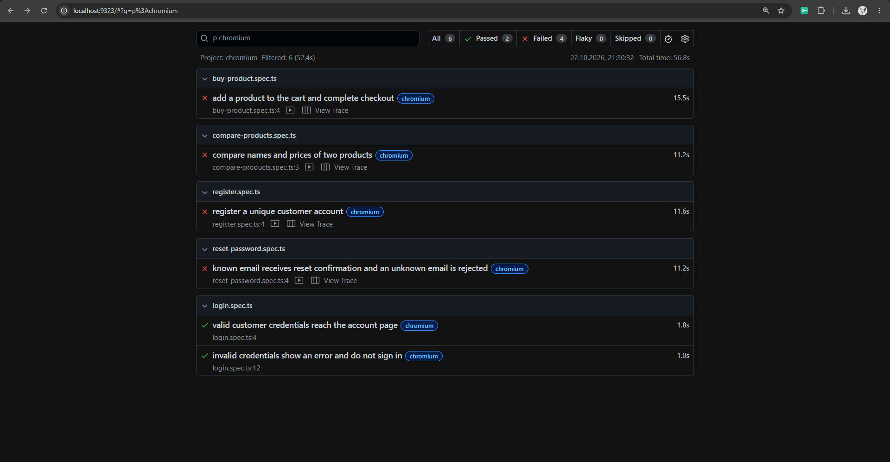
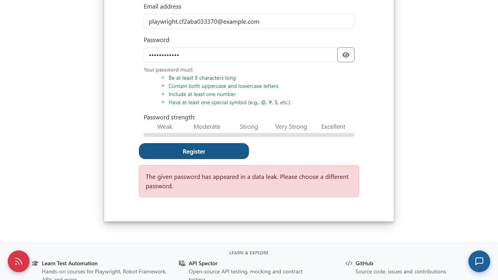
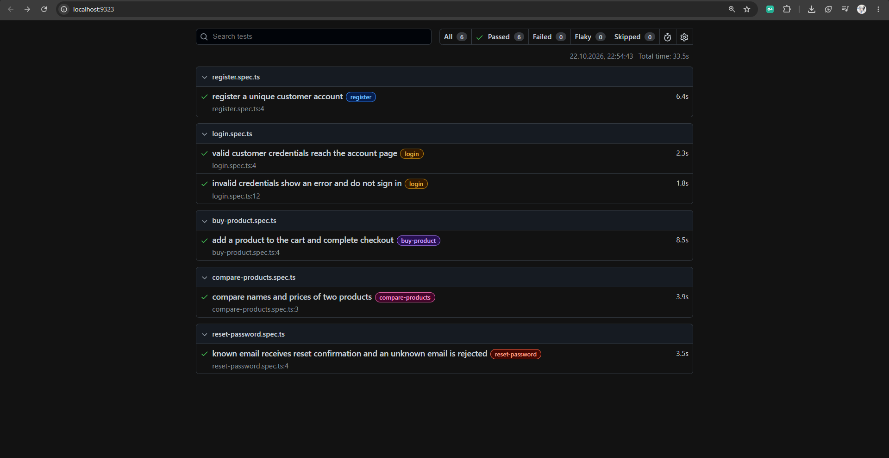

# My Review for Automated Tests and AI Outputs

**Student Assignment:** SIS 2 - Test Automation with Playwright  
**Course:** Software Testing and Debugging, KBTU  
**AI Tool Used:** ChatGPT - 6 Thinking  
**Framework:** Playwright with TypeScript

---

## 1. Initial Project Generation

I started by identifying the requirements for the automated testing assignment and organizing them into a prompt for the AI tool.

I asked the AI to generate a project using the **Page Object Model (POM), Custom Fixtures, and a Test Data Factory**.

I specified the five required test scenarios:

- Customer registration
- Login
- Buying a product
- Comparing two products
- Resetting a password

I also provided the required project structure, including the `pages/`, `tests/`, `fixtures/`, and `data/` directories, along with the Playwright configuration file.

The AI generated the initial project files. After placing them in the appropriate directories, I ran the test suite to check whether the implementation worked against the actual website.

---

## 2. Issues Found During the First Test Run



The first test run was unsuccessful: only two tests passed, while four failed. Each failure required further investigation.

### Issue 1: Product Selection in the Purchase Test

**File:** `pages/product.page.ts`

The purchase test failed because Playwright could not find the product using the selector `getByTestId('product-1')`.

The error message was:

```text
Expect "toBeVisible" getByTestId('product-1') with timeout 10000ms
waiting for getByTestId('product-1')
```

The product selector generated by the AI did not match the actual catalog elements on the website. The product selection logic needed to be adjusted to match the website's actual behavior.

### Issue 2: Product Selection in the Comparison Test

**File:** `pages/product.page.ts`

The product comparison test failed for the same reason as the purchase test. Playwright could not locate `product-1` in the catalog.

Since both tests used the same product selection method, the issue affected both scenarios. The product selection logic therefore needed to be corrected in the shared Page Object rather than separately in each test.

### Issue 3: Country Selection During Registration

**File:** `pages/register.page.ts`

The registration test failed while selecting the country from the registration form.

Playwright found the country dropdown, but it could not find an option matching the value provided by the test data. The error indicated that the locator was found, but the expected option could not be selected.

This showed that the country selection logic or the value supplied by the test data did not match the actual options available on the website.

### Issue 4: Password Reset Confirmation

**File:** `pages/forgot-password.page.ts`

The password reset test failed because Playwright could not find the expected confirmation message after submitting the form.

The test searched for several possible confirmation elements, but none of them became visible within the timeout.

The expected message selectors did not match the actual response displayed by the website. The Page Object needed to be adjusted to handle the website's actual behavior.

---

> One unexpected result during the first test run was that the login test passed even though the registration test failed.

---

## 3. Second Prompt and Further Corrections

After reviewing the four failures, I prepared a second prompt containing the error messages and relevant code context. I asked the AI to fix the existing project in the appropriate files instead of generating an unrelated implementation.

I also specified the intended test order:

1. Registration
2. Login
3. Buying a product
4. Comparing two products
5. Resetting a password

The AI generated updated code for the project. I replaced the previous implementation with the updated files and ran the tests again.

This time, the registration test was the remaining failure. The error was related to the password rather than the country selection or the registration form fields.

---

## 4. Registration Password Issue



**File:** `data/user.factory.ts`

The registration page rejected the original hardcoded password:

```ts
password: 'TestPass123!',
```

The website displayed the following message:

> The given password has appeared in a data leak. Please choose a different password.

Although the password met the visible complexity requirements, the website rejected it because it had appeared in a data leak.

I sent a third prompt asking the AI to modify `data/user.factory.ts` so that a unique password would be generated for each registration attempt. I requested a targeted change instead of regenerating the entire project.

The AI updated the password generation logic to use the existing `randomUUID()` function. This allowed the test data factory to generate a different password for each registration attempt.

---

## 5. Final Test Results



After applying the password change, I ran the test suite again.

All six tests passed successfully in **33.5 seconds**.

The login scenario contains two separate tests: one for valid credentials and one for invalid credentials. This is why the project has five test scenario files but six individual tests.

---

## 6. What I Learned

This assignment helped me understand how to use Playwright with TypeScript for automated web testing and how to organize tests using the Page Object Model.

I learned how to:

- Organize an automated testing project into page objects, fixtures, test files, and test data utilities.
- Run Playwright tests and interpret the errors reported by the test runner.
- Investigate failures by examining error messages and identifying which part of the code caused the problem.
- Use AI to generate an initial implementation and then refine it based on actual test results.
- Generate unique test data to avoid reusing the same registration email address and password.
- Understand why code generated by AI must be tested against the actual website instead of being accepted without verification.